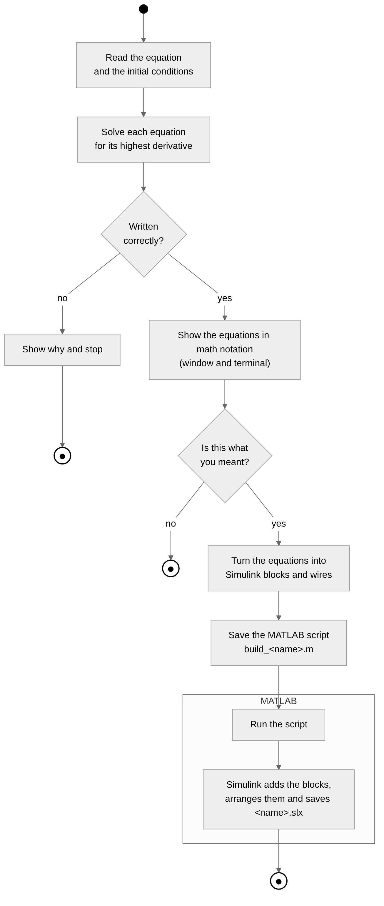
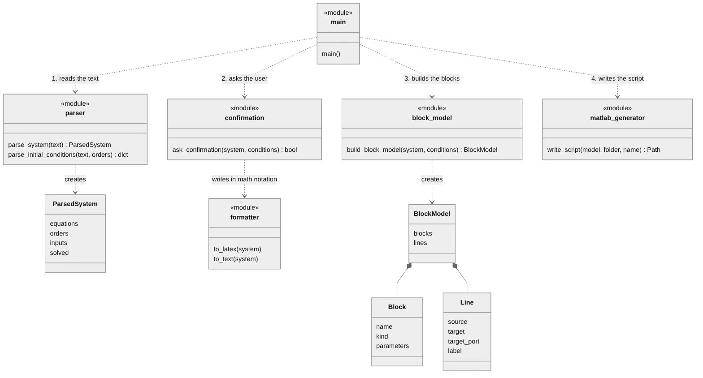

# Simulink Model Generator

Type a differential equation as plain text, like `2x'' + 0.5x' + 8x = F` for a mass on a spring. The program writes a MATLAB script that builds the Simulink model of this equation. Run the script in MATLAB, press Run, and the Scope shows the graph of how the system behaves over time.

**Who it is for:** anyone who uses MATLAB and Simulink to solve differential equations and wants to see the graphs, to understand how a physical system behaves: a mass on a spring, a pendulum, a system that slows down or oscillates...

## How it works

**Input:** the equation, typed in the terminal. Optionally, the starting values of the variables (initial conditions).

**Outputs:**
- the equation written back in math notation, in the terminal and in a small window, so you can check it was read correctly;
- a MATLAB script, `build_<name>.m`. Run in MATLAB, it builds the Simulink model and saves it as `<name>.slx`.

The program goes through these steps. If the equation is badly written, or if you answer `n`, it stops before building anything.



The model is built the usual way for a differential equation in Simulink:

1. Isolate the highest derivative: `2x'' + 0.5x' + 8x = F` becomes ẍ = (F − ẋ/2 − 8x) / 2.
2. Chain one Integrator per derivative: ẍ → ẋ → x. An Integrator is the block that turns ẍ into ẋ, and ẋ into x.
3. Send every term back into a Sum block with its sign, through Gain blocks (and Product, Abs or Fcn blocks for nonlinear terms).
4. Show the input and the result on a Scope.

The code has one module per step. `main.py` calls them one after the other:



## Installation

You need Python 3.10 or newer. To run the model, you also need MATLAB R2018a or newer with Simulink. The program itself runs without MATLAB.

```bash
git clone https://github.com/simlirette/semestral-work-ite.git
cd semestral-work-ite
pip install -r requirements.txt
```

This installs [SymPy](https://www.sympy.org), which reads and solves the equations, and [matplotlib](https://matplotlib.org), which draws them in the window.

## Usage

```bash
python main.py "EQUATION" [--ic VALUES] [--name NAME] [--output FOLDER] [--no-gui]
```

| Option | What it does | Default |
|---|---|---|
| `EQUATION` | The equation(s), in quotes | (required) |
| `--ic` | Initial conditions, like `"x(0)=1, x'(0)=0.5"` | all 0 |
| `--name` | Name of the Simulink model and of the `.slx` file | `my_model` |
| `--output` | Folder where the MATLAB script is saved | `output` |
| `--no-gui` | Show the equations in the terminal only, without a window | off |

### Writing the equation

| Write | Meaning |
|---|---|
| `x'`, `x''`, `x'''`, `x''''` | 1st, 2nd, 3rd, 4th derivative of x |
| `3x'` or `3*x'` | 3 times x' |
| `x'^3` | x' to the power 3 |
| `abs(x)`, `sqrt(x)`, `sin(x)`, `cos(x)`, `exp(x)` | functions |
| `;` | separates the equations of a system |
| `u`, `F`, `v`... | a letter without an apostrophe is an input: a Step block |

Decimals work, but they are always shown as fractions: `0.5x'` is shown as ẋ/2, and its Gain is `1/2`. Writing `(t)` after a variable is allowed: `x''(t) + 3x'(t) = u(t)` is the same as `x'' + 3x' = u`.

### Writing the initial conditions

An initial condition is the value of a variable when the simulation starts (t = 0). Write them like the equation, separated by commas:

```bash
python main.py "x'' + 0.5x' + 9.81sin(x) = 0" --ic "x(0)=1"
```

- Each value goes into one Integrator. For a 2nd-order equation, you can give x(0) and x'(0), but not x''(0).
- Values you don't give are 0.
- Negative numbers and fractions work: `x(0)=-2, x'(0)=1/3`.

### Examples

```bash
python main.py "2x'' + 0.5x' + 8x = F" --name spring                  # mass on a spring, with friction, pushed by a force F
python main.py "x'' + 0.5x' + 9.81sin(x) = 0" --ic "x(0)=1" --name pendulum   # pendulum let go at 1 rad
python main.py "y'' + 2y'^3 + y = u"                                  # nonlinear equation
python main.py "y''' + 5y'' + 2y' + y + z = u ; z'' + z' + z + y = v" # two equations that depend on each other
```

### What happens

1. The program shows how it read your equation, in math notation (dots for derivatives, x⁽⁴⁾ from the 4th one), and the equation solved for the highest derivative:

   ```
   Interpreted equation:
       2ẍ(t) + ẋ(t)/2 + 8x(t) = F(t)

   Solved for the highest derivative:
       ẍ(t) = (F(t) - ẋ(t)/2 - 8x(t)) / 2

   Is this what you meant? [y/n]:
   ```

   The same thing opens in a small window, written like an equation in Word.

2. If you answer `y`, it saves the MATLAB script `output/build_<name>.m`.
3. Run the script in MATLAB. It builds the model, arranges the blocks, saves `<name>.slx` next to the script and opens it. Press Run, then open the Scope to see the graph.

If the program can't read the equation (no `=`, unknown function, more unknowns than equations...), it says why and stops.

## Running the tests

```bash
python test_main.py
```

All the tests are in the `tests/` folder. None of them needs MATLAB. How the program is tested, with examples of inputs and outputs: [docs/tests.md](docs/tests.md).

## Project structure

```
src/
  parser.py            reads the text: equations and initial conditions
  formatter.py         writes the equations in math notation (window and terminal)
  confirmation.py      shows the equations and asks you to confirm
  block_model.py       turns the equations into Simulink blocks and wires
  matlab_generator.py  writes the MATLAB script that builds the model
tests/                 one test file per module
docs/tests.md          how the program is tested
docs/diagrams/         the diagrams above (images and their Mermaid sources)
main.py                runs the program
test_main.py           runs all the tests
```

## Limitations

- The highest derivative must appear simply: `x''^2` or `sin(x'')` can't be solved.
- Coefficients must be numbers. In `m*x'' + k*x = F`, m and k are read as input signals, not as values: write `2x'' + 8x = F`.
- Use one-letter names (x, y, z), with digits if needed (x1, x2). Longer names work, but the dots are drawn on their last letter.
- An integral inside the equation is not supported.
- Only math blocks are used (Integrator, Sum, Gain, Product, Abs, Fcn). No Saturation, switches or subsystems, and no Transfer Function block.
- Simulink places the blocks itself, so with many equations the wires can cross.
- Inputs are Step blocks with Simulink's default settings (0, then 1 from t = 1 s), and the simulation lasts 100 s. Both can be changed in Simulink.

## License

MIT, see [LICENSE](LICENSE).
